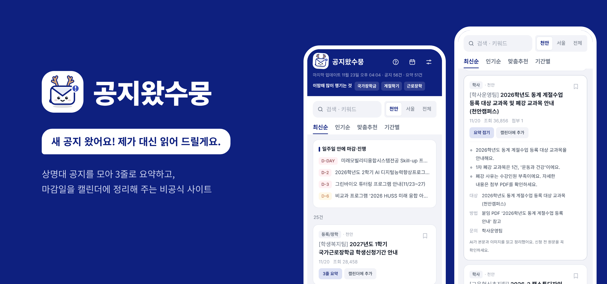
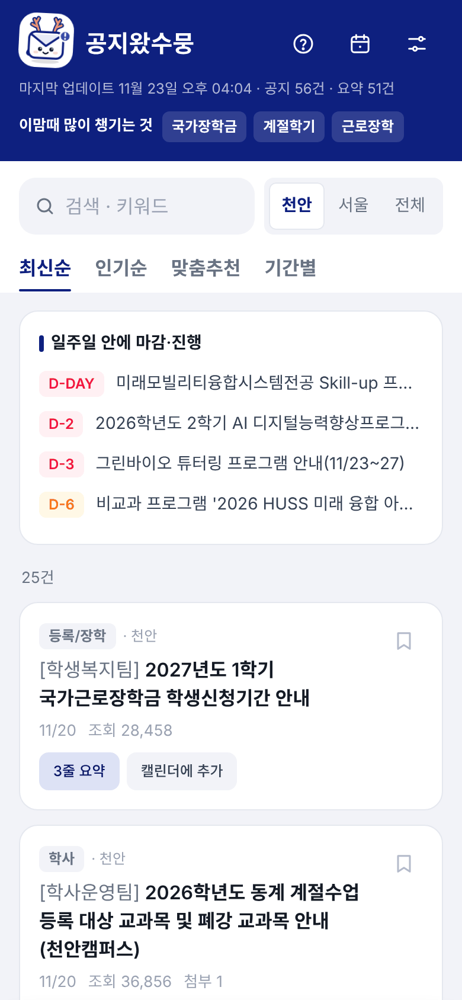
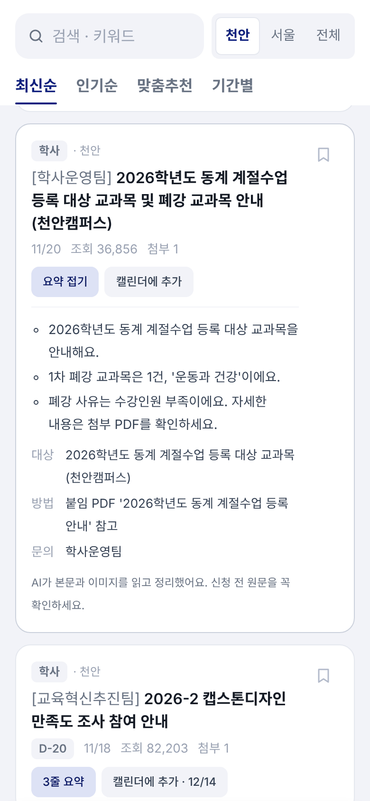
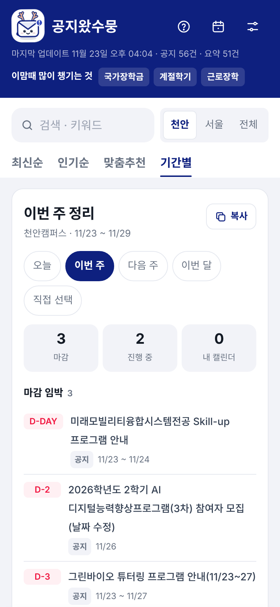
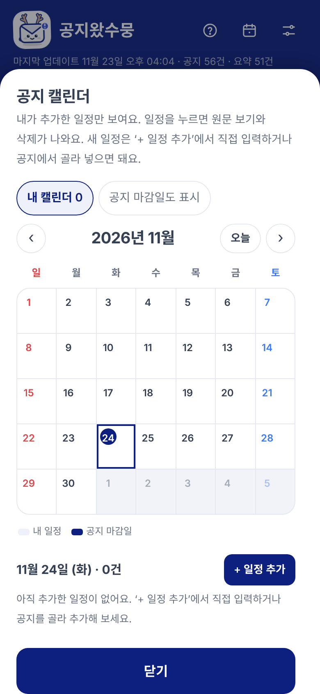
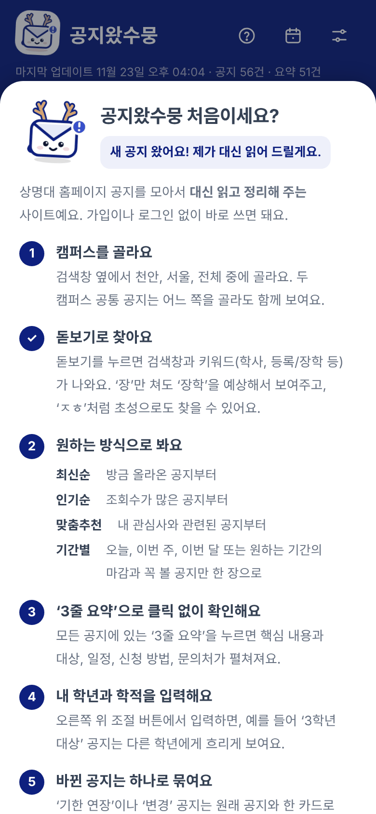
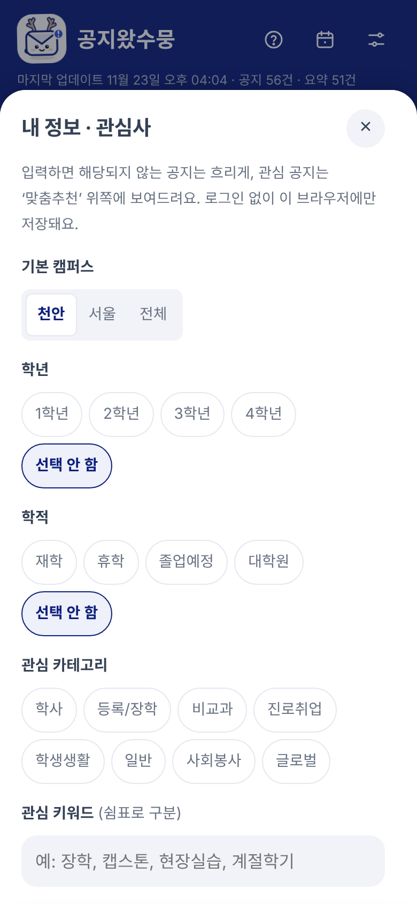

  

  <a href="https://seojin-pixel.github.io/SangmyungNotice/web/"><b>사이트 열기</b></a>
  &nbsp;|&nbsp;
  <a href="#화면">화면</a>
  &nbsp;|&nbsp;
  <a href="#할-수-있는-일">할 수 있는 일</a>
  &nbsp;|&nbsp;
  <a href="#이렇게-써-보세요">사용 방법</a>

  
  
  

# 공지왔수뭉

상명대학교 홈페이지 공지를 모아 대신 읽고 정리해 주는 비공식 공지 사이트입니다.
공지마다 3줄 요약과 대상·기간·신청 방법·문의처를 보여 주고 마감이 가까운 공지는 위에 따로 모아 줍니다.

가입이나 로그인은 없습니다. 학년, 관심사, 저장한 공지는 사용하는 브라우저에만 남고 서버로 보내지 않습니다.
공지는 하루 다섯 번(오전 9시부터 3시간 간격) 새로 가져옵니다.

## 화면

<table>
  <tr>
    <td align="center" width="25%"> 일주일 안 마감과 최신 공지</td>
    <td align="center" width="25%"> 3줄 요약과 대상·방법·문의</td>
    <td align="center" width="25%"> 이번 주 마감 한 장 정리</td>
    <td align="center" width="25%"> 공지 캘린더</td>
  </tr>
</table>

화면 더 보기 (처음 안내, 내 정보 설정)

 
<table>
  <tr>
    <td align="center" width="25%"> 처음 방문하면 나오는 안내</td>
    <td align="center" width="25%"> 학년·학적·관심사 설정</td>
    <td width="25%"></td>
    <td width="25%"></td>
  </tr>
</table>

## 할 수 있는 일

| 기능 | 하는 일 |
|---|---|
| 3줄 요약 | 본문과 이미지를 읽어 핵심 세 줄로 줄이고 대상·기간·방법·문의처를 따로 보여 줍니다. |
| 마감 임박 | 일주일 안에 마감되거나 진행되는 공지를 D-day와 함께 맨 위에 모읍니다. |
| 해당 여부 | 학년과 학적을 입력하면 내가 대상이 아닌 공지를 흐리게 보여 줍니다. |
| 맞춤추천 | 관심 카테고리와 키워드에 맞는 공지를 위로 올립니다. |
| 변경 묶기 | '기한 연장', '변경' 공지를 원래 공지와 한 카드로 묶고 바뀐 마감일을 표시합니다. |
| 기간별 정리 | 오늘·이번 주·다음 주·이번 달·직접 고른 기간의 마감을 한 장으로 모으고 단톡방에 붙일 글로 복사합니다. |
| 캘린더 | 공지 마감일을 사이트 안 캘린더에 넣거나(매주·매월 반복 가능) 구글 캘린더로 보냅니다. |
| 시기별 강조 | 그 시기에 많이 찾는 키워드(국가장학금, 계절학기 등)와 맞는 공지를 먼저 보여 줍니다. |
| 혜택 모아 보기 | 장학금·상금·지원금 공지와 금액 합계를 보여 줍니다. |
| 똑똑한 검색 | '장'만 쳐도 '장학'을 예상하고 'ㅈㅎ'처럼 초성으로도 찾습니다. |

## 이렇게 써 보세요

1. 검색창 옆에서 천안, 서울, 전체 중 캠퍼스를 고릅니다. 두 캠퍼스 공통 공지는 어느 쪽에서나 보입니다.
2. 최신순, 인기순, 맞춤추천, 기간별 가운데 원하는 순서로 봅니다.
3. 공지의 '3줄 요약'을 누르면 원문을 열지 않아도 핵심 내용과 신청 방법을 확인할 수 있습니다.
4. 오른쪽 위 조절 버튼에서 학년·학적·관심사를 입력하면 나에게 맞는 공지가 위로 올라옵니다.
5. 챙겨야 할 공지는 '캘린더에 추가'로 일정에 넣거나 북마크로 저장합니다.

마감일을 찾지 못한 공지는 직접 날짜를 골라 캘린더에 넣을 수 있습니다.

## 알아 두기

- 요약, 마감일, 대상, 금액은 자동으로 정리한 내용이라 틀릴 수 있습니다. 신청 전에는 꼭 원문을 확인해 주세요.
- 상명대학교 공식 서비스가 아닌 학생 개인 프로젝트입니다. 모든 공지의 원문은 [상명대학교 홈페이지](https://www.smu.ac.kr/kor/life/notice.do)에 있습니다.
- 입력한 정보와 저장한 공지는 이 브라우저에만 남습니다. 다른 기기나 브라우저에서는 처음 상태로 열립니다.

## 휴대폰으로 열기

카메라로 찍으면 [seojin-pixel.github.io/SangmyungNotice/web](https://seojin-pixel.github.io/SangmyungNotice/web/)이 열립니다.
